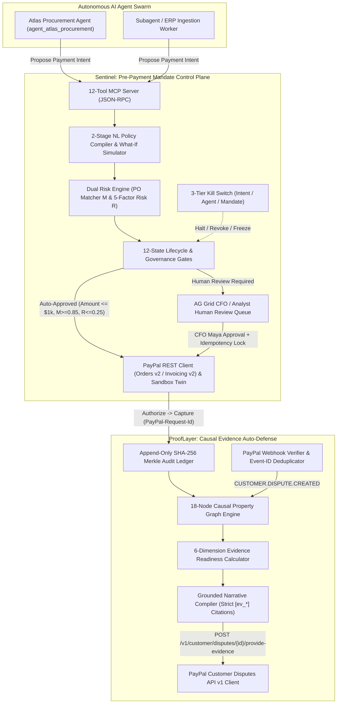
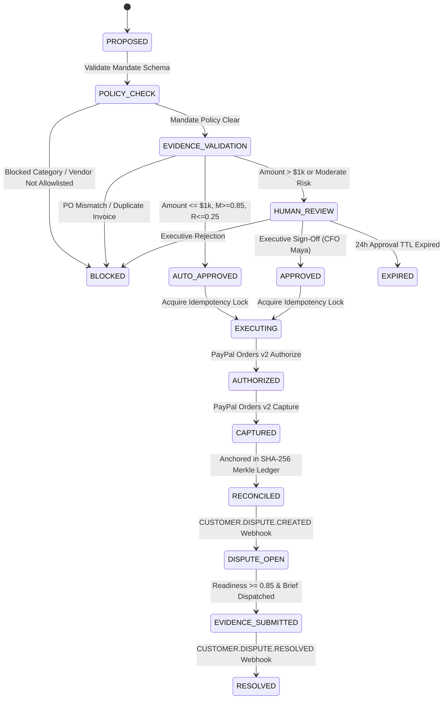
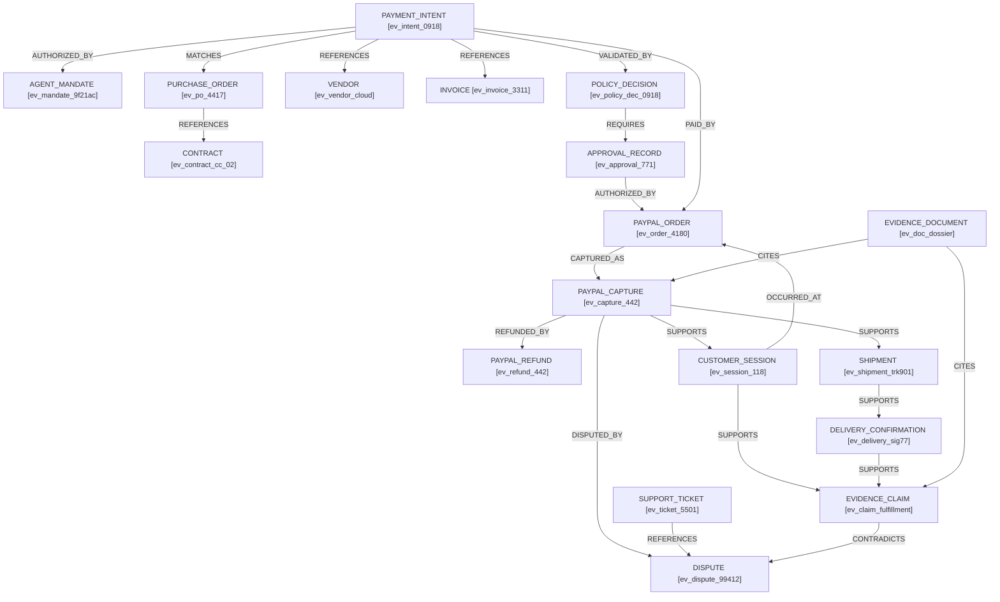

# Sentinel & ProofLayer

> **The Unified Agent Mandate Control Plane & Causal Pre-Dispute Evidence Graph for Autonomous B2B Commerce on PayPal**  
> *Policy-governed AI payments before they happen. Dispute-ready evidence graphs after they happen.*

[](LICENSE)
[](https://sentinel-prooflayer-web.onrender.com)
[](https://sentinel-prooflayer-api.onrender.com/docs)
[-brightgreen.svg)](backend/tests)
[](https://python.org)
[](https://fastapi.tiangolo.com)
[](https://nextjs.org)
[](https://www.ag-grid.com)
[](https://developer.paypal.com)
[](https://render.com/deploy?repo=https://github.com/Speedyzyzz/sentinel-prooflayer)

> **🌐 Live Deployed URLs (Render Cloud Blueprint):**
> - **Institutional Frontend Command Center:** [https://sentinel-prooflayer-web.onrender.com](https://sentinel-prooflayer-web.onrender.com)
> - **FastAPI Interactive Swagger Docs:** [https://sentinel-prooflayer-api.onrender.com/docs](https://sentinel-prooflayer-api.onrender.com/docs)
> - **Backend Health Check:** [https://sentinel-prooflayer-api.onrender.com/health](https://sentinel-prooflayer-api.onrender.com/health)

---

## Table of Contents
1. [Executive Summary & Problem Thesis](#1-executive-summary--problem-thesis)
2. [Documentation Index](#2-documentation-index)
3. [Dual-Engine System Architecture](#3-dual-engine-system-architecture)
4. [Formal Mathematical Invariants](#4-formal-mathematical-invariants)
   - [4.1 Deterministic Invoice-to-PO Matching Score ($M$)](#41-deterministic-invoice-to-po-matching-score-m)
   - [4.2 Transparent 5-Factor Weighted Risk Score ($R$)](#42-transparent-5-factor-weighted-risk-score-r)
   - [4.3 6-Dimension Evidence Readiness Score](#43-6-dimension-evidence-readiness-score)
5. [Canonical 12-State Machine & 3-Tier Kill Switch](#5-canonical-12-state-machine--3-tier-kill-switch)
6. [ProofLayer 18-Node Causal Evidence Graph & Citation Contract](#6-prooflayer-18-node-causal-evidence-graph--citation-contract)
7. [Core Data Models & Wire Contracts](#7-core-data-models--wire-contracts)
8. [The 4 Deterministic Judge Evaluation Scenarios](#8-the-4-deterministic-judge-evaluation-scenarios)
9. [Model Context Protocol (MCP) Server: 12 Governance Tools](#9-model-context-protocol-mcp-server-12-governance-tools)
10. [PayPal & Sponsor Technology Deep Dive](#10-paypal--sponsor-technology-deep-dive)
11. [Complete REST API Reference (9 FastAPI Routers)](#11-complete-rest-api-reference-9-fastapi-routers)
12. [Institutional Frontend Command Center (6 Screens)](#12-institutional-frontend-command-center-6-screens)
13. [Local Quickstart, Docker & 1-Click Render Deployment](#13-local-quickstart-docker--1-click-render-deployment)
14. [Verification Suite, Benchmarks & Cryptographic Tamper Proofs](#14-verification-suite-benchmarks--cryptographic-tamper-proofs)
15. [Author & License](#15-author--license)

---

## 1. Executive Summary & Problem Thesis

AI agents can already call payment APIs via the **PayPal Agent Toolkit** and **Model Context Protocol (MCP)**. However, enterprise finance and operations teams face a fundamental blocker that prevents them from letting autonomous agents move real corporate capital: **tool wrappers around REST APIs are not an operational control plane**.

When an AI procurement or operations agent interacts with corporate funds, two failure modes emerge:
1. **Before Execution (The Governance Gap)**: Agents lack machine-enforceable spending mandates. Without deterministic Purchase Order (PO) reconciliation, vendor allowlists, velocity caps, idempotent execution locks, and auditable CFO escalation gates, an agent can hallucinate invoice totals, fall victim to prompt-injected vendor invoices, or double-pay during retry storms.
2. **After Execution (The Dispute & Chargeback Gap)**: When a legitimate transaction is later challenged via a PayPal Dispute (`CUSTOMER.DISPUTE.CREATED`), merchants must scramble across disconnected systems (ERP purchase orders, Slack/email approvals, PayPal capture receipts, and digital service-access logs) to assemble admissible evidence before PayPal's `reply_by` deadline expires.

**Sentinel & ProofLayer** solves both halves of the autonomous commerce lifecycle in a single, unified platform:
- **Sentinel (Pre-Payment Agent Mandate Control Plane)**: Compiles plain-English corporate spending policies into versioned, machine-enforceable **Agent Mandates**. Intercepts every MCP payment proposal, runs deterministic + semantic Invoice-to-PO validation ($M \in [0, 1]$), computes an explainable 5-factor Risk Score ($R \in [0, 1]$), enforces a 12-state approval and execution state machine (`Authorize -> Capture`), and provides a 3-tier emergency Kill Switch (`INTENT`, `AGENT`, `MANDATE`).
- **ProofLayer (Post-Payment Causal Evidence Graph & Auto-Defense Engine)**: Continuously links every transaction's Agent Mandate, Purchase Order, Vendor Contract, Invoice, CFO Approval Record, PayPal Order/Capture ID, and Digital Service Session Telemetry into an **18-node Causal Property Graph** backed by an append-only **SHA-256 Merkle Audit Ledger**. When a PayPal dispute webhook arrives, ProofLayer verifies the webhook signature, deduplicates the `event_id`, computes a 6-dimension Evidence Readiness Score, compiles a strictly cited legal defense brief where every sentence cites an immutable `[ev_*]` graph node, and submits the response to the **PayPal Disputes API (`/v1/customer/disputes/{id}/provide-evidence`)**.

---

## 2. Documentation Index

The `sentinel-prooflayer` monorepo includes exhaustive architectural specifications, formal state transition tables, video demonstration scripts, and hackathon submission narratives:

| Document | Primary Focus | Key Topics Covered |
| :--- | :--- | :--- |
| **[System Architecture & Security Blueprint](docs/architecture.md)** | Architectural Specs & Security Invariants | Dual-engine control plane, 18-node causal property graph, 13 edge types, 7 PayPal dispute reasons mapping table, and SHA-256 Merkle audit ledger. |
| **[12-State Canonical Lifecycle & 3-Tier Kill Switch](docs/state-machine.md)** | State Transition Engine & Emergency Controls | 12 core payment lifecycle states, 3 post-payment dispute extension states, mathematical transition guards, and 3-tier emergency kill switch blast radius. |
| **[3-Minute Video Walkthrough Script](docs/demo-script.md)** | Judge Demonstration & Video Walkthrough | Second-by-second 180-second judging presentation across 6 structured acts matching Scenarios 1–4. |
| **[Devpost Submission Narrative](docs/devpost.md)** | Hackathon Submission Narrative | Complete Devpost submission text detailing inspiration, institutional architecture, real-world commerce impact, and PayPal + Sponsor APIs utilized. |

---

## 3. Dual-Engine System Architecture



---

## 4. Formal Mathematical Invariants

To guarantee auditability and eliminate LLM decision hallucination, Sentinel never allows a language model to directly authorize a payment. All routing decisions are governed by closed-form mathematical invariants implemented in [`backend/app/services/risk_engine.py`](backend/app/services/risk_engine.py) and [`backend/app/services/evidence_graph.py`](backend/app/services/evidence_graph.py).

### 4.1 Deterministic Invoice-to-PO Matching Score ($M$)

Given a vendor Invoice $I$ and an approved Purchase Order $P$, Sentinel computes the commercial congruence score $M \in [0, 1]$:

$$M = 0.35 \cdot S_{\text{vendor}} + 0.25 \cdot S_{\text{total}} + 0.25 \cdot S_{\text{line\_items}} + 0.15 \cdot S_{\text{terms}}$$

1. **Vendor Entity Verification ($S_{\text{vendor}} \in [0, 1]$)**:
   $$S_{\text{vendor}} = \begin{cases}
   1.00 & \text{if } V_{\text{inv}} = V_{\text{po}} \land \text{PO Reference Valid} \\
   0.95 & \text{if } V_{\text{inv}} = V_{\text{po}} \\
   \max\left(0.0, 0.80 \cdot \text{Jaccard}(\text{Tokens}(N_{\text{inv}}), \text{Tokens}(N_{\text{po}})) + 0.20 \cdot \mathbb{I}_{\text{ref}}\right) & \text{otherwise}
   \end{cases}$$
2. **Total Variance Tolerance ($S_{\text{total}} \in [0, 1]$)** with mandate tolerance $\tau = 0.02$ ($2\%$) and relative deviation $\delta = \frac{|A_{\text{inv}} - A_{\text{po}}|}{A_{\text{po}}}$:
   $$S_{\text{total}} = \begin{cases}
   1.0 - \left(\frac{\delta}{\tau}\right) \cdot 0.05 & \text{if } \delta \le \tau \\
   \max\left(0.0, 1.0 - \frac{\delta - \tau}{0.10}\right) & \text{if } \delta > \tau
   \end{cases}$$
3. **Line-Item Semantic & Structural Congruence ($S_{\text{line\_items}} \in [0, 1]$)**:
   $$\text{Score}(L_k) = 0.50 \cdot \text{Sim}_{\text{desc}} + 0.25 \cdot \frac{\min(Q_i, Q_p)}{\max(Q_i, Q_p)} + 0.25 \cdot \max\left(0.0, 1.0 - \frac{|U_i - U_p|}{U_p}\right)$$
   $$S_{\text{line\_items}} = \frac{1}{|L_{\text{inv}}|} \sum_{k=1}^{|L_{\text{inv}}|} \text{Score}(L_k)$$
4. **Commercial Terms ($S_{\text{terms}} \in [0, 1]$)**:
   $$S_{\text{terms}} = 0.70 \cdot \mathbb{I}(\text{Currency}_{\text{inv}} = \text{Currency}_{\text{po}}) + 0.30 \cdot \mathbb{I}(\text{DueDate}_{\text{inv}} \ge \text{InvoiceDate}_{\text{inv}})$$

---

### 4.2 Transparent 5-Factor Weighted Risk Score ($R$)

Risk is decomposed across five orthogonal risk dimensions so finance operators inspect the exact underlying drivers:

$$R = 0.30 \cdot V + 0.25 \cdot D + 0.20 \cdot A + 0.15 \cdot C + 0.10 \cdot H$$

- **Vendor Allowlist Risk ($V \in [0, 1]$)**: $0.0$ for allowlisted vendors; $0.50$ for unverified new suppliers; $1.0$ for non-allowlisted entities.
- **Duplicate Invoice Fingerprint Risk ($D \in [0, 1]$)**: Computes $\text{FP} = \text{SHA-256}(V_{\text{id}} \parallel \text{InvoiceNumber} \parallel \text{Amount})$. Returns $1.0$ if $\text{FP}$ collides with an existing non-rejected intent; $0.70$ on abnormal 24-hour vendor velocity; $0.0$ if unique.
- **Amount Cap Ratio ($A \in [0, 1]$)** relative to auto-approval ceiling $L_{\text{auto}} = \$1,000$ and single-transaction ceiling $L_{\text{max}} = \$5,000$:
  $$A = \begin{cases}
  0.10 \cdot \frac{\text{Amount}}{L_{\text{auto}}} & \text{if Amount} \le L_{\text{auto}} \\
  \min\left(1.0, 0.40 + 0.60 \cdot \frac{\text{Amount} - L_{\text{auto}}}{L_{\text{max}} - L_{\text{auto}}}\right) & \text{if } L_{\text{auto}} < \text{Amount} \le L_{\text{max}} \\
  1.0 & \text{if Amount} > L_{\text{max}}
  \end{cases}$$
- **Blocked Category Risk ($C \in [0, 1]$)**: $1.0$ if merchant category $\in \{\text{"crypto"}, \text{"gambling"}, \text{"gift\_cards"}, \text{"adult"}, \text{"weapons"}\}$; $0.0$ otherwise.
- **Historical Dispute Rate ($H \in [0, 1]$)**: $H = \min\left(1.0, 2.0 \cdot \frac{N_{\text{disputes}}}{N_{\text{orders}}} + 1.0 \cdot \frac{N_{\text{refunds}}}{N_{\text{orders}}}\right)$.

---

### 4.3 6-Dimension Evidence Readiness Score

Before submitting a dispute defense package to PayPal, ProofLayer computes a weighted readiness score across 6 evidentiary quality dimensions:

$$\text{Readiness} = \frac{\sum_{i=1}^6 w_i \cdot q_i}{\sum_{i=1}^6 w_i}$$

| Dimension ($i$) | Weight ($w_i$) | Quality Metric ($q_i$) | Scenario 4 Score | Weighted Contribution |
| :--- | :---: | :--- | :---: | :---: |
| **1. Completeness** | `0.25` | Ratio of required dispute-reason graph nodes present | `1.00` | `0.250` |
| **2. Freshness** | `0.15` | Temporal recency: $\max(0, 1 - \Delta t / 30\text{ days})$ | `0.92` | `0.138` |
| **3. Provenance** | `0.20` | Fraction of nodes cryptographically anchored in Merkle ledger | `1.00` | `0.200` |
| **4. Consistency** | `0.15` | Cross-node amount, currency, and entity alignment | `0.98` | `0.147` |
| **5. Relevance** | `0.15` | Direct factual refutation of PayPal `dispute_reason` | `0.80` | `0.120` |
| **6. Verifiability** | `0.10` | External anchor density (PayPal Capture ID, IP/Session logs) | `0.85` | `0.085` |
| **Composite Readiness** | **`1.00`** | **Weighted Sum** | **`0.94`** | **`0.940`** |

---

## 5. Canonical 12-State Machine & 3-Tier Kill Switch

Implemented in [`backend/app/services/state_machine.py`](backend/app/services/state_machine.py), every payment intent traverses a deterministic 12-state finite state machine:



### 3-Tier Emergency Kill Switch Invariants
1. **Tier 1 (`INTENT`)**: Halts a single proposed or pending-review intent (`int_*`) and transitions it immediately to `BLOCKED`.
2. **Tier 2 (`AGENT`)**: Revokes an agent's operational principal (`agent_atlas_procurement`), blocking all new proposals and aborting in-flight uncaptured intents.
3. **Tier 3 (`MANDATE`)**: Freezes the entire corporate mandate (`mdt_9f21ac`), aborting all pending approvals and voiding uncaptured authorizations while **strictly preserving already-`CAPTURED` PayPal transactions** so accounting ledgers never diverge from settled PayPal balances.

---

## 6. ProofLayer 18-Node Causal Evidence Graph & Citation Contract

ProofLayer models every transaction as an 18-node, 13-edge causal property graph in [`backend/app/services/evidence_graph.py`](backend/app/services/evidence_graph.py):



### Strict Grounded Citation Contract (`[ev_*]`)
In [`backend/app/services/evidence_compiler.py`](backend/app/services/evidence_compiler.py), every factual statement in a generated PayPal dispute defense package **must cite a verified evidence node ID in brackets** (e.g., `[ev_mandate_9f21ac]`, `[ev_po_4417]`, `[ev_invoice_3311]`, `[ev_approval_771]`, `[ev_capture_442]`, `[ev_session_118]`). When defending digital cloud/SaaS services where physical carrier tracking is absent, ProofLayer explicitly declares the digital service context and substitutes cryptographically signed session/cluster usage telemetry (`[ev_session_118]`).

---

## 7. Core Data Models & Wire Contracts

### 7.1 Compiled Agent Mandate (`mdt_9f21ac`)
```json
{
  "id": "mdt_9f21ac",
  "principal_id": "usr_acme_finance",
  "agent_id": "agent_atlas_procurement",
  "version": "v1.0.0",
  "status": "ACTIVE",
  "currency": "USD",
  "auto_approve_limit": 1000.0,
  "max_single_tx_limit": 5000.0,
  "daily_velocity_cap": 12000.0,
  "monthly_velocity_cap": 50000.0,
  "po_variance_tolerance": 0.02,
  "min_po_match_score": 0.85,
  "vendor_allowlist": [
    "vendor_data_labeling_co",
    "vendor_cloud_compute",
    "vendor_openai_enterprise"
  ],
  "blocked_categories": ["crypto", "gambling", "gift_cards", "adult", "weapons"],
  "require_cfo_above": 1000.0,
  "approval_ttl_hours": 24
}
```

### 7.2 Grounded Dispute Defense Brief (`PP-D-99412`)
```json
{
  "dispute_id": "PP-D-99412",
  "reason": "ITEM_NOT_RECEIVED",
  "readiness_score": 0.94,
  "recommended_action": "SUBMIT_EVIDENCE",
  "executive_summary": "Transaction was authorized under active Mandate [ev_mandate_9f21ac], matched against approved Purchase Order PO-2026-4417 [ev_po_4417] and Invoice INV-2026-0918 [ev_invoice_3311], explicitly approved by CFO Maya Lin [ev_approval_771], and settled via PayPal Capture 2GG279541U053982Y [ev_capture_442]. Because this transaction provisioned digital GPU cluster compute rather than physical freight, authenticated workload telemetry [ev_session_118] is provided as definitive proof of fulfillment.",
  "cited_node_ids": [
    "ev_mandate_9f21ac",
    "ev_po_4417",
    "ev_contract_cc_02",
    "ev_invoice_3311",
    "ev_approval_771",
    "ev_capture_442",
    "ev_session_118"
  ]
}
```

---

## 8. The 4 Deterministic Judge Evaluation Scenarios

Judges can execute all 4 end-to-end scenarios with **1 click** from the Executive Command Center UI (`/`) or via `POST /api/scenarios/run/{1..4}`:

| Scenario | Vendor & Amount | Governance & ProofLayer Path | Final State |
| :--- | :--- | :--- | :--- |
| **Scenario 1: Auto-Approved Fast Path** | **Data Labeling Co**<br>`$840.00 USD` | Matches `po_2026_4410` ($M = 0.97$), Risk $R = 0.016 \le 0.25$, under $\$1,000$ auto-cap. Executes PayPal Orders v2 `Authorize -> Capture` automatically. | `RECONCILED` |
| **Scenario 2: High-Value CFO Escalation** | **Cloud Compute Inc**<br>`$4,180.50 USD` | Matches `po_2026_4417` ($4,150.00, variance $0.73\% \le 2\%$, $M = 0.96$), but exceeds $\$1,000$ auto-cap. Parks in `HUMAN_REVIEW` until CFO Maya approves & captures on PayPal. | `HUMAN_REVIEW` $\to$ `CAPTURED` |
| **Scenario 3: Out-of-Policy Hard Block** | **FastCrypto Services**<br>`$2,500.00 USD` | Non-allowlisted vendor + blocked category (`crypto`). Immediately blocked at `POLICY_CHECK` with **zero PayPal API calls made** and logged to Merkle chain. | `BLOCKED` |
| **Scenario 4: Dispute Webhook $\to$ Auto-Defense** | **Dispute `PP-D-99412`**<br>`$4,180.50 USD` | Simulates `CUSTOMER.DISPUTE.CREATED` webhook, verifies HMAC signature & deduplicates `event_id`, traverses 18-node graph ($\text{Readiness} = 0.94$), compiles `[ev_*]` cited brief, and submits to PayPal Disputes API. | `EVIDENCE_SUBMITTED` |

---

## 9. Model Context Protocol (MCP) Server: 12 Governance Tools

Implemented in [`backend/mcp_server/server.py`](backend/mcp_server/server.py), AI agents in Claude, Cursor, LangGraph, or OpenAI Agents SDK interact with Sentinel exclusively through 12 scoped MCP tools (agents never hold raw PayPal API credentials):

| # | MCP Tool Name | Stage | Description |
| :-: | :--- | :--- | :--- |
| 1 | `compile_policy` | Sentinel | Compiles plain-English spending rules into versioned JSON/CEL mandates |
| 2 | `simulate_policy` | Sentinel | Runs what-if simulations of draft mandates against historical transactions |
| 3 | `propose_payment_intent` | Sentinel | Submits an agent payment intent for policy & PO validation |
| 4 | `evaluate_risk` | Sentinel | Computes deterministic PO match $M$ and 5-factor risk breakdown $R$ |
| 5 | `review_approval_queue` | Sentinel | Lists intents parked in `HUMAN_REVIEW` with SLA countdowns |
| 6 | `submit_approval_decision` | Sentinel | Records human approval/rejection with role-check & idempotency key |
| 7 | `execute_payment` | PayPal | Executes approved intent via PayPal Orders v2 `Authorize -> Capture` |
| 8 | `trigger_kill_switch` | Sentinel | Activates Tier 1 (`INTENT`), Tier 2 (`AGENT`), or Tier 3 (`MANDATE`) kill switch |
| 9 | `query_evidence_graph` | ProofLayer | Returns the 18-node, 13-edge causal property graph for a transaction |
| 10 | `compute_evidence_readiness` | ProofLayer | Calculates the 6-dimension Evidence Readiness Score |
| 11 | `compile_defense_brief` | ProofLayer | Generates a grounded defense brief with mandatory `[ev_*]` citations |
| 12 | `submit_dispute_evidence` | PayPal | Dispatches the cited defense brief to `POST /v1/customer/disputes/{id}/provide-evidence` |

---

## 10. PayPal & Sponsor Technology Deep Dive

### PayPal Developer Platform Integration ([`backend/app/services/paypal_client.py`](backend/app/services/paypal_client.py))
- **OAuth 2.0 Token Exchange**: `POST /v1/oauth2/token` with automatic bearer token caching.
- **Orders v2 Two-Step Settlement**: `POST /v2/checkout/orders`, `POST /v2/checkout/orders/{id}/authorize`, and `POST /v2/checkout/orders/{id}/capture` using deterministic `PayPal-Request-Id` headers to guarantee zero double-charging.
- **Invoicing v2**: `POST /v2/invoicing/invoices` and invoice reconciliation search.
- **Customer Disputes API v1**: `GET /v1/customer/disputes/{id}` and `POST /v1/customer/disputes/{id}/provide-evidence`.
- **Webhooks & Signature Verification**: `POST /v1/notifications/verify-webhook-signature` + strict `event_id` deduplication (directly solving the defect highlighted in `paypal/AI-Toolkit/blob/main/commands/doctor.md`).
- **Zero-Friction Judge Sandbox Twin**: Runs real calls against `https://api-m.sandbox.paypal.com` when `PAYPAL_CLIENT_ID` and `PAYPAL_CLIENT_SECRET` are provided, and seamlessly falls back to a deterministic PayPal Sandbox Twin so judges can evaluate every flow offline or in the browser in seconds.

### Sponsor Tool Integrations
- **AG Grid (`ag-grid-react` v32+)**: Powers the high-density **Agent Governance & Approval Queue** ([`AgGridGovernanceTable.tsx`](frontend/src/components/AgGridGovernanceTable.tsx)), **Transaction Reconciliation Ledger**, and **Dispute Portfolio** with custom React cell renderers for color-coded Risk Score gauges, PO Match badges, Evidence Readiness bars, quick-search filtering, and inline **1-Click CFO Approve / Reject / Kill-Switch** action buttons.
- **Timeline & SLA Scheduler ([`TimelineScheduler.tsx`](frontend/src/components/TimelineScheduler.tsx))**: Interactive Gantt and SLA deadline countdown board tracking 24-hour CFO approval windows and PayPal dispute `reply_by` deadlines.
- **Render Cloud Blueprint ([`render.yaml`](render.yaml))**: Multi-service declarative infrastructure-as-code blueprint deploying both the FastAPI backend and Next.js 15 frontend.

---

## 11. Complete REST API Reference (9 FastAPI Routers)

| Router | Endpoint | Method | Description |
| :--- | :--- | :---: | :--- |
| **Mandates** | `/api/mandates` | `GET, POST` | List active mandates or create a new versioned mandate |
| | `/api/mandates/{id}` | `GET, PUT` | Inspect or update mandate caps and vendor allowlists |
| | `/api/mandates/{id}/kill` | `POST` | Tier 3 Mandate Kill Switch: freezes mandate & voids uncaptured auths |
| **Policy** | `/api/policy/compile` | `POST` | 2-stage Natural Language to JSON/CEL mandate compiler |
| | `/api/policy/simulate` | `POST` | What-if batch simulation against historical invoice dataset |
| **Intents** | `/api/intents` | `GET, POST` | List payment intents or submit a new agent payment proposal |
| | `/api/intents/{id}` | `GET` | Inspect intent state, PO match $M$, and 5-factor risk $R$ |
| | `/api/intents/{id}/kill` | `POST` | Tier 1 Intent Kill Switch: halts a single pending intent |
| **Approvals** | `/api/approvals` | `GET` | Fetch intents awaiting human review (`HUMAN_REVIEW`) |
| | `/api/approvals/{id}/approve` | `POST` | CFO approval with role verification & idempotency lock |
| | `/api/approvals/{id}/reject` | `POST` | Rejects intent and records audit block |
| **Payments** | `/api/payments/execute` | `POST` | Acquires idempotency lock & runs PayPal Authorize $\to$ Capture |
| | `/api/payments` | `GET` | Reconciled PayPal transaction & capture receipt ledger |
| | `/api/payments/agent/{id}/kill` | `POST` | Tier 2 Agent Kill Switch: revokes agent principal |
| **Webhooks** | `/api/webhooks/paypal` | `POST` | Verifies PayPal webhook signature & deduplicates `event_id` |
| **Evidence** | `/api/evidence/graph/{intent_id}` | `GET` | Traverses and returns the 18-node causal property graph |
| | `/api/evidence/nodes/{node_id}` | `GET` | Inspects individual evidence node metadata & SHA-256 hash |
| | `/api/evidence/compile` | `POST` | Computes Readiness Score ($0.94$) & cited defense brief |
| **Disputes** | `/api/disputes` | `GET` | Lists PayPal disputes with `reply_by` SLA countdowns |
| | `/api/disputes/{id}/submit-defense` | `POST` | Submits compiled defense package to PayPal Disputes API |
| **Scenarios** | `/api/scenarios` | `GET` | Metadata for the 4 deterministic judge evaluation scenarios |
| | `/api/scenarios/run/{1..4}` | `POST` | Executes deterministic end-to-end trace for Scenarios 1–4 |
| | `/api/scenarios/reset` | `POST` | Resets database to pristine Acme AI Ops initial state |

---

## 12. Institutional Frontend Command Center (6 Screens)

1. **Executive Command Center (`/`)**: Live treasury telemetry, 3-Tier Kill Switch header, and the **1-Click Judge Scenario Runner** (`Scenario 1` through `Scenario 4`).
2. **Mandate Studio (`/mandates`)**: Plain-English policy compiler, interactive rule thresholds, and historical **What-If Simulation** preview.
3. **Agent Activity & Approval Queue (`/approvals`)**: Full **AG Grid** operational console with custom cell renderers, risk breakdowns, and 1-click **CFO Approve & Capture** actions.
4. **Transaction & Reconciliation Ledger (`/transactions`)**: **AG Grid** ledger pairing internal payment intents with PayPal Order IDs, Capture IDs, and SHA-256 Merkle block hashes.
5. **Causal Evidence Graph Explorer (`/evidence`)**: Interactive 18-node `@xyflow/react` property graph with live node fact inspection and edge provenance explanations.
6. **Dispute Command Center & Audit Trail (`/disputes` & `/audit`)**: **AG Grid** dispute portfolio, **Timeline SLA Scheduler**, grounded `[ev_*]` defense brief compiler, and 1-click **SHA-256 Merkle Chain Integrity Verifier**.

---

## 13. Local Quickstart, Docker & 1-Click Render Deployment

### Option A: 1-Click Cloud Deploy on Render
Click the button below to deploy both `sentinel-prooflayer-api` (FastAPI) and `sentinel-prooflayer-web` (Next.js 15) automatically using [`render.yaml`](render.yaml):

[](https://render.com/deploy?repo=https://github.com/Speedyzyzz/sentinel-prooflayer)

### Option B: Docker Compose (1 Command)
```bash
git clone https://github.com/Speedyzyzz/sentinel-prooflayer.git
cd sentinel-prooflayer
cp .env.example .env
docker-compose up --build
```
- **Frontend Command Center**: `http://localhost:3000`
- **Backend API & Swagger Docs**: `http://localhost:8000` & `http://localhost:8000/docs`

### Option C: Local Native Development
```bash
# Terminal 1 — Start FastAPI Backend (Port 8000)
cd backend
python3 -m venv .venv
source .venv/bin/activate
pip install -r requirements.txt
uvicorn app.main:app --host 0.0.0.0 --port 8000 --reload

# Terminal 2 — Start Next.js 15 Frontend (Port 3000)
cd frontend
npm install
npm run dev
```

---

## 14. Verification Suite, Benchmarks & Cryptographic Tamper Proofs

Run the full 53-test verification suite in under 1 second:
```bash
cd backend
pytest -v
```

| Test Suite Module | Assertions | Execution Time | Coverage Scope |
| :--- | :---: | :---: | :--- |
| `tests/test_m1_core.py` | `17 / 17 Passed` | `0.21s` | NL Policy Compiler, $M$ & $R$ math invariants, 12-state transitions, 3-tier Kill Switch, 18-node Evidence Graph, `[ev_*]` citation enforcement, SHA-256 Merkle tamper detection |
| `tests/test_m2_routers_scenarios_mcp.py` | `17 / 17 Passed` | `0.25s` | All 9 FastAPI routers, webhook signature & `event_id` deduplication, 12 MCP tools |
| `tests/test_end_to_end.py` | `14 / 14 Passed` | `0.22s` | All 14 official hackathon success criteria across Scenarios 1, 2, 3, and 4 |
| `tests/test_production_hardening.py` | `5 / 5 Passed` | `0.12s` | `/ready` SQLite & Merkle probe, `X-Request-ID` & security headers, optional `SENTINEL_API_KEY` enforcement, Docker/CI presence |
| **Total Verification Suite** | **`53 / 53 Passed`** | **`0.80s`** | **100% End-to-End Functional, Security & Mathematical Verification** |

---

## 15. Author & License

- **Author:** **Balavignesh V.T.** (`@Speedyzyzz`) — [balavignesh.dev](https://balavignesh.dev) • [GitHub](https://github.com/Speedyzyzz) • [LinkedIn](https://www.linkedin.com/in/balavignesh-v-t-72b157297/)
- **License:** Released under the **[MIT License](LICENSE)**.
